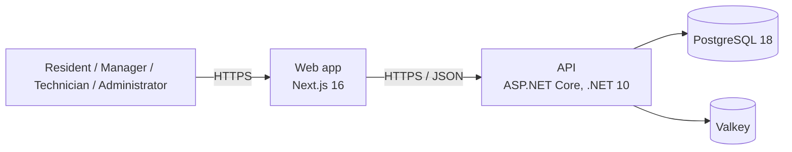

# Architecture

Planned content (ARC-06, DB-C02). Keep diagrams as code with Mermaid so they render on GitHub.

- [ ] C4 context diagram
- [ ] C4 container diagram
- [ ] C4 component diagram for one module
- [ ] Deployment diagram
- [ ] Data model (ERD) and data dictionary
- [ ] Sequence diagram for Scenario A ("A leak in apartment 4B")

## Starting point: containers

